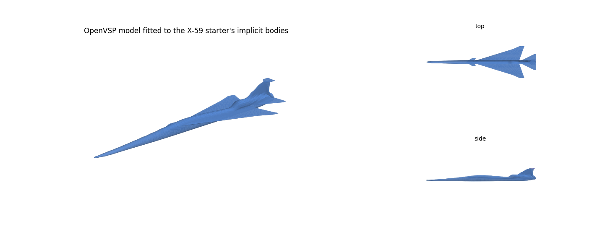
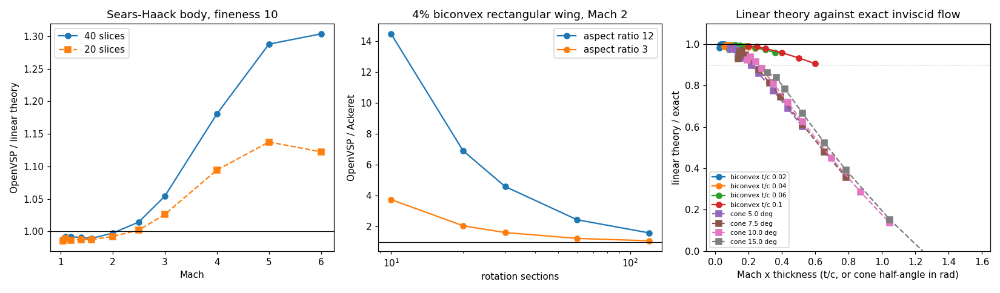

# nTop_vsp

nTop custom blocks that turn **nTop implicit bodies into an OpenVSP model** and run aerodynamic analyses on one shared
**Flight Condition** (Mach and altitude through the US Standard Atmosphere 1976, alpha, beta, reference area, span,
chord and moment point):

- OpenVSP 3.56's **VSPAERO**, **Wave Drag** and **Parasite Drag**, plus **Body Lift** and **RASAero II**;
- computed in nTop on the implicit body: **Modified Newtonian**, **Tangent Wedge / Cone** and a **Viscous
  Correction**.

**Aero Database (VSP)** sums any mix of them, each over its own Mach range, into a six-degree-of-freedom database.
**Center of Pressure (VSP)** and **Polar Plot (VSP)** read it. Because the geometry stays parametric in nTop, its
inputs can be database variables too: `examples/x59_doe.py` runs a design of experiments over an X-59-style wing.

Test geometry: the X-59 hackathon starter in `../x59-hackathon-starter` (MIT License, Copyright (c) 2026
matthewmuellernTop; notice in `examples/X-59_STARTER_LICENSE.txt`).

## How it works

```
implicit bodies ─► OpenVSP Fuselage / Wing / Duct (VSP) ─► OpenVSP Model (VSP) ─► <case>.vsp3
Flight Condition (VSP) ──────────────── into every analysis ─────────────────────────┤
   VSPAERO · Wave Drag · Parasite Drag · Body Lift · RASAero II · Newtonian · Tangent Wedge · Viscous
                                  │ (one Contribution block each)
                     Aero Database (VSP) ─► readers, Center of Pressure, Polar Plot
```

Driver blocks write a settings file (`key = value`, SI units) and run `python -m vsp_ntop.<module> <settings>` with
nTop's **Run Command**. The drivers run OpenVSP and VSPAERO and write CSV files that reader blocks import. A failed run
stops the notebook with the driver's error; every run leaves `<Case Name>.ntvsp.log`. Modified Newtonian and the
Viscous Correction are pure nTop block graphs.

- `blocks/`: the custom blocks, one `.ntop` each (File > Import, or drag into a notebook).
- `examples/`: the X-59 aero database and mixed-analysis notebooks, and the DOE script.
- `vsp_ntop/`: the drivers (an installable package).
- `tests/`: E2E tests on a prebuilt notebook (`e2e.ntop`).
- `validation/`: wave drag Mach range, Newtonian, RASAero II rocket (`rasaero/REPORT.md`), noncircular body
  (`noncircular/REPORT.md`), CAD export and lofted CAD studies.

## Setup

1. Unpack OpenVSP 3.56 (Windows 64-bit).
2. `pip install -e .` into a Python 3.8+ (installs `ambiance` and matplotlib). A conda Python works without
   activating its environment.
3. Set, then restart nTop:
   - `NTOP_PYTHON_PATH`: that Python's executable;
   - `VSP_PATH`: the folder with `vspscript.exe` and `vspaero.exe`;
   - `RASAERO_PATH` (RASAero II only): the folder with `RASAero II.exe` (free from rasaero.com, not redistributable).

Each driver block's only path input is **Working Directory** (empty: `%TEMP%/ntop_vsp`). nTop asks once to trust Run
Command blocks.

## Blocks

| Block | Output | Purpose |
|---|---|---|
| OpenVSP Fuselage (VSP) | text | implicit bodies as OpenVSP Fuselages |
| OpenVSP Wing (VSP) | text | implicit lifting surfaces as Wings: span axes, symmetry, extension into the body, force accounting |
| OpenVSP Duct (VSP) | text | the side wall of a body with planar ends, as an open Fuselage |
| OpenVSP Model (VSP) | model path | builds `<case>.vsp3` from component lines |
| OpenVSP Model Check (VSP) | list of reals | per component: distance from the OpenVSP surface to the nTop contours |
| OpenVSP Model Mesh (VSP) | mesh | OpenVSP's tessellation |
| OpenVSP CAD Export (VSP) | file path | STEP or IGES by OpenVSP's own export: trimmed, stitched or untrimmed |
| Lofted CAD Export (VSP) | file path | fuselage bodies as STEP solids fitted straight to their nTop slices |
| Flight Condition (VSP) | results path | Mach with altitudes, alphas, betas; the reference |
| VSPAERO Solver Settings (VSP) | text | threads, wake, far field, convergence and solver options |
| VSPAERO Analysis (VSP) | results path | model, flight condition, Mach range, body wakes, settings, pressure export |
| VSPAERO Coefficient (VSP) | list of reals | any polar column, one value per case |
| Wave Drag (VSP) | results path | area-rule wave drag at the supersonic Mach numbers |
| Wave Drag Result / Area Distribution (VSP) | list of reals | CD_wave per Mach; one rotation section's areas |
| Parasite Drag Component (VSP) | text | one component's form factor, laminar fraction, Q, roughness |
| Parasite Drag (VSP) | results path | component buildup, one run per flight point |
| Parasite Drag Result / Component Values (VSP) | list of reals | totals per flight point; one buildup column |
| Body Lift (VSP) | results path | fuselage normal force: slender-body nose lift, optional viscous crossflow |
| RASAero II (VSP) | results path | RASAero II on a rocket's OpenVSP model |
| Modified Newtonian (VSP) | results path | Newtonian forces by nTop Surface Integrals |
| Modified Newtonian on Mesh (VSP) | results path | the same pressure, integrated over a mesh (much faster) |
| Tangent Wedge on Mesh (VSP) | results path | oblique shock or Taylor-Maccoll cone windward, Prandtl-Meyer leeward |
| Modified Newtonian Pressure (VSP) | scalar field | static pressure (Pa) of one case on the body |
| Surface Pressure (VSP) | Scalar Point Map | exported static pressure (Pa) of one case |
| Surface Pressure Jump (VSP) | Scalar Point Map | VSPAERO thin-surface pressure jump plus a Reference Pressure |
| Viscous Correction (VSP) | results path | skin friction at every condition, in nTop |
| Aero Coefficients (VSP) | results path | six coefficient lists from anywhere |
| Aero Contribution (VSP) and its wrappers | text | one analysis's share of the database: Use, Mach range, Scale |
| Aero Database (VSP) | results path | sums contributions at every condition; design variables; DOE file |
| Aero Database Coefficient / Table (VSP) | list of reals / table | one column, or the whole database |
| Center of Pressure (VSP) | list of points | centres of pressure, or each alpha sweep's aerodynamic centre |
| Polar Plot (VSP) | image path | one database quantity against another (matplotlib) |

Lengths go to OpenVSP in metres; references are nTop quantities with units.

## From implicit to OpenVSP



Component blocks take a list of **Bodies** and **Names** (wings also one **Span Axis** per body). nTop cuts each body
with **Slice Body** and exports the contours to CLI; **Slice Spacing** and **Contour Tolerance** set the resolution.

- **Fuselage fit** (`fit.fit_fuselage`): half the **Sections** by clustering, the rest where interpolating the outline
  misses most. Pointed ends become point sections placed from a √area fit (rounded below p = 0.75); blunt ends get a
  flat cap within half a slice spacing. Skinning angles are set per section and side from the slices; OpenVSP's
  defaults flared blunt ends by a tenth of the radius. Sections are written straight into the `.vsp3` (2 s against
  51 s through the API).
- **Wing fit** (`fit.fit_wing`): chord line, twist, thickness and airfoil per slice; sections where they stop varying
  linearly (**Section Tolerance**). **Symmetry** is OpenVSP's planar symmetry; **Trailing Edge: Sharp** shears a blunt
  base onto the chord line.
- **Wings in a body**: **Extension** carries a wing inboard, stopping short of the axis (crossing thin surfaces gave
  VSPAERO no finite result). **Force Accounting**: Whole Wing, Exposed Strip (inboard strips' loads removed from
  VSPAERO's `.lod`), or Exposed Strip + Carry-over, which adds TR 1307's $K_{B(W)}$ share of each wing's normal force
  on the body (`carryover.py`: supersonic planar model, slender-body theory elsewhere). On a cruciform rocket exposed
  strips are 10% under to 5% over SU2's fin lift (Mach 2 to 5).
- **Fit check**: `<case>.ntvsp.model.csv`, **OpenVSP Model Check (VSP)**. X-59: 0.1 to 10 mm mean per component,
  largest 435 mm at the nacelle inlet step. The whole model takes about 70 s in nTop.
- **Slicer conventions** (nTop 6.3.3): contours come in the frame's axes, except along exactly ±x, ±y, ±z where they
  come in world axes; the driver handles all cases.

## Ducts and CAD

**OpenVSP Duct (VSP)** cuts a body with planes turning from the inlet plane to the outlet plane and makes its outer or
inner wall an open Fuselage; sides are skinned free (OpenVSP's coupled defaults bowed a tube by 0.1 m). A waisted duct
fits within 0.8 mm on 1 m.

**OpenVSP CAD Export (VSP)** (`run_cad.py`): Trimmed (one intersected solid), Stitched (one solid per component) or
Untrimmed surfaces, always declared in metres. Optional **Planar End Caps** rebuild flat caps as planes
(`step_caps.py`). Use Stitched for nTop: it round-trips within 0.05 mm, Trimmed does not, and Trimmed drops a duct's
inner wall. Results: `validation/cad_export/results.txt`.

**Lofted CAD Export (VSP)** (`loft.py`, `step_write.py`; numpy only) skips OpenVSP's skinning, which cannot follow a
flattened section. One bicubic B-spline surface is least-squares fitted through every slice, split at the four
centre-line crossings; corners over 30° become sharp edges (chines). The surface is cut into clamped B-spline faces,
one closed solid per body, AP214 in millimetres (`docs/STEP_FORMAT.md`). Against exact bodies the loft is within
0.001 mm mean and 0.05 mm max, where OpenVSP's surface is 0.02 to 0.04 mm mean and 0.24 to 0.36 mm max
(`validation/loft_cad/results.txt`). Limits: one contour per slice, bodies along x, sharp edges only at the four
split points.

## VSPAERO

Defaults **Wing: Thin, Fuselage: None**: on the X-59 every configuration with a thick fuselage gave wrong supersonic
drag, overlapping thick bodies broke the mesh, and thin fuselages gave NaN.

- The panel method (Thick) is a subsonic option; keep body panels near square (**Panel Aspect Ratio** 1.5).
- Thin surfaces crossing near a tip give NaN above Mach 1: cut them in nTop.
- **Wake Nodes** 16 and a fixed wake: within 0.2% and 0.1% of the slower settings.
- Moments are reported in body-axis signs (Cl right wing down, Cm nose up, Cn nose right).
- **Convergence check**: GMRES targets reached, finite coefficients and, with a relaxed wake, CL, CD and Cm changing
  less than 10% over the last iteration. Failures stop the notebook unless set to warn
  (`<case>.ntvsp.convergence.csv`).
- For parallel runs, split a sweep into Analysis blocks with adjacent Mach ranges.

## Wave drag range

`validation/wave_drag_mach.py`: OpenVSP's area rule is within 1.4% of linear theory on a Sears-Haack body to Mach 2.5
(+18% at Mach 4). Wings need many rotation sections at high aspect ratio (30 is enough for the X-59). Linear theory
holds to Mach × forebody angle ≈ 0.2 and Mach × t/c ≈ 0.5: for a slender supersonic aircraft roughly **Mach 1.2 to
2.5**. Blunt bases and inlets make the result grow with the slice count.



## Flight condition

**Mach** and **Altitude** pair item by item into flight points (US Standard Atmosphere 1976 via `ambiance`); every
point runs at each **Angle of Attack** and **Sideslip** (alpha fastest). The reference travels with the conditions.
VSPAERO, Newtonian, Tangent Wedge and the Viscous Correction also have **Mach Min** and **Mach Max**.

## Body lift and RASAero II

**Body Lift (VSP)** samples the fuselages in rings normal to x. Slender-body lift
dCN/dx = (dS/dx / Sref) sin 2α cos(α/2) acts where the area grows; Allen-Perkins crossflow (Jorgensen's Cdn) is
optional. **Slender Body (Section Shape)** uses each section's crossflow apparent mass (source panels) instead of its
area, so a section wide across the crossflow lifts more (part of SU2's noncircular nose lift is beyond it). With Exposed Strip + Carry-over fins, CN is
within −8% to +4% of SU2 at Mach 2 to 5.

**RASAero II (VSP)** fits a RASAero II design to the OpenVSP model (nose, tube, boattail, one fin set), drives RASAero
II's window (MSAA, needs a desktop session) at whole degrees of total alpha and each altitude, and returns a
coefficient table. The fitted design is within 1 to 2% of hand-written designs.

## Newtonian, tangent wedge and viscous correction

- **Modified Newtonian (VSP)**: Cp = Cp_max max(−n·V, 0)², n the unit gradient of the body's field; one Surface
  Integral per component. Cp_max: Rayleigh pitot (Modified), 2 (Classical) or a **Cp Max Field**. No
  self-shadowing.
- **Modified Newtonian on Mesh (VSP)**: the same pressure from the implicit **Body**, integrated over a **Mesh** of it
  by `run_newtonian_mesh.py` (numpy). The log reports how well the Body's normals match the Mesh; under half the area
  within 25° is an error (a misplaced or wrongly scaled mesh). An OpenVSP Model Mesh is accepted (CN within 1 to 4%,
  CA about 10% of nTop's mesh).
- **Tangent Wedge on Mesh (VSP)** (`local_methods.py`): windward **Tangent Wedge** (exact oblique shock) or **Tangent
  Cone** (Taylor-Maccoll, tabulated per Mach), rising as sin²δ to Cp_max above detachment; leeward Prandtl-Meyer or
  Newtonian shadow; strongly turned faces blend to **Separated Faces**. Supersonic only. Use it for thin surfaces:
  on a slender body it over-predicts crossflow lift several times. On the rocket's fins it is within 3% of SU2 at
  Mach 3 to 5.
- **Viscous Correction (VSP)**: skin friction at the Newtonian (or freestream) edge state, Eckert laminar, van
  Driest II turbulent, sudden transition.

Axes: x along **Aft Axis**, z toward **Up Axis**. Each writes `<Flight Condition>_<Case Name>.ntvsp.coefficients.csv`
for **Coefficients Contribution (VSP)**. Validation: `validation/newtonian/REPORT.md` (sphere CD within 8e-4).

**Run time**: Surface Integrals cost 1 to 3 s each per condition; the mesh blocks cost one mesh and a sum per
condition (330 conditions on 611,000 faces: 99 s for four runs, against 750 s for 4 conditions by Surface
Integrals).

## Surface pressures

**Export Pressures** (Off by default) on VSPAERO Analysis, Modified Newtonian on Mesh and Tangent Wedge on Mesh
writes one point map per flight condition case: `<Case Name>.ntvsp.pressure.<Case>.csv` (p_inf + q Cp, Pa) and, for
VSPAERO's thin surfaces, `.pressure_jump.<Case>.csv` (q ΔCp). Read them with **Surface Pressure (VSP)** or **Surface
Pressure Jump (VSP)**, which adds a required **Reference Pressure**. Case numbers are the Case column of
`<Flight Condition>.ntvsp.flight.csv`. Modified Newtonian's pressure is the field of **Modified Newtonian Pressure
(VSP)**; Body Lift exports none.

## Aero database

Each analysis enters the database through a **contribution** (Aero Contribution or its wrappers) with **Use** (all,
drag only, all but drag), **Mach Min / Max** and **Scale**. The database (`run_database.py`) interpolates each
contribution to every condition, moves it to the moment point and reference, and sums: CL, CD, CY in wind axes; Cl,
Cm, Cn in body-axis signs; each contribution's share in its own columns. It reproduced an earlier X-59 database to
1e-12 and a hand calculation to 5e-13.

**`examples/X-59 Aero Database.ntop`**: VSPAERO, Wave Drag and Parasite Drag at Mach 0.6 to 1.8, alpha −2 to 8,
beta 0 and 4 (60 conditions, about 23 minutes on 16 threads). **`examples/x59_doe.py`** runs it per design with
`ntopcl -j` and collects `runs/x59_doe.csv`. Per degree at beta 0:

| Wing span | Inner sweep | CL_α M0.6 | Cm_α M0.6 | CL_α M1.5 | Cm_α M1.5 | CD₀ M1.5 |
|---|---|---|---|---|---|---|
| 8 m | 68.3° | 0.0255 | -0.0067 | 0.0276 | -0.0102 | 0.0229 |
| 9 m | 68.3° (baseline) | 0.0294 | -0.0091 | 0.0322 | -0.0135 | 0.0240 |
| 10 m | 68.3° | 0.0348 | -0.0132 | 0.0377 | -0.0183 | 0.0256 |
| 9 m | 65° | 0.0306 | -0.0068 | 0.0342 | -0.0116 | 0.0245 |
| 9 m | 71° | 0.0281 | -0.0110 | 0.0303 | -0.0150 | 0.0235 |

The baseline's aerodynamic centre moves from 20.95 m subsonic to 21.98 m at Mach 1.8 (AeroSandbox: 20.90 m).

## Coverage of OpenVSP's options

Every VSPAERO, Parasite Drag and Wave Drag option (`dev/inventory.txt`) is a block input or deliberately left out:
reference velocity, X-Z symmetry, FEM/Tecplot output, CG calculation, stall model, rotors, unsteady and stability
runs, control surfaces, `-fem` and `-interrogate`, other atmospheres, excrescences, inflow/outflow faces. Parasite
Drag's default turbulent Cf is Roughness Schlichting Avg Compressible: OpenVSP 3.56's "Schlichting Compressible"
applies no Mach correction.

## Tests and headless runs

```bash
dev/venv/Scripts/python.exe -m pytest
```

The tests (about 80 s) run `tests/e2e.ntop` with ntopcl: a sphere, a plate and a 15° cone at Mach 3 and 8, checking
the Newtonian, on-mesh and tangent blocks, the database, the pressure export and both readers against closed-form
answers. They need a signed-in nTop and only this repo. ntopcl runs at low priority on half the cores and is stopped
above 8 GB (`NTOPCL_MAX_THREADS`, `NTOPCL_MEMORY_CAP_GB`). ntopcl may not exit after Run Command blocks; the runners
stop it once the output is written.

The `.ntop` files are generated by local tooling that is not part of the repo.

## Known limits

- Runs with the same Working Directory and Case Name overwrite each other.
- One closed contour per cut; fuselages are sliced along +x, wing span axes must be normal to x.
- OpenVSP's skinning smooths abrupt steps (0.43 m at the X-59's nacelle inlet).
- VSPAERO's exported pressures are for viewing: VSPAERO computes its forces from vortex edges.
- nTop pairs lists item by item ("Input list length mismatch" otherwise).
- The on-mesh friction sums of `ntop_newtonian` were not carried over: nTop does not allow lists of lists.
