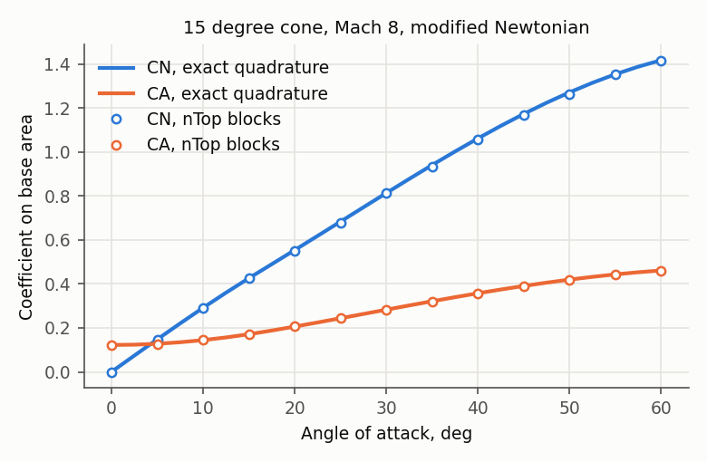
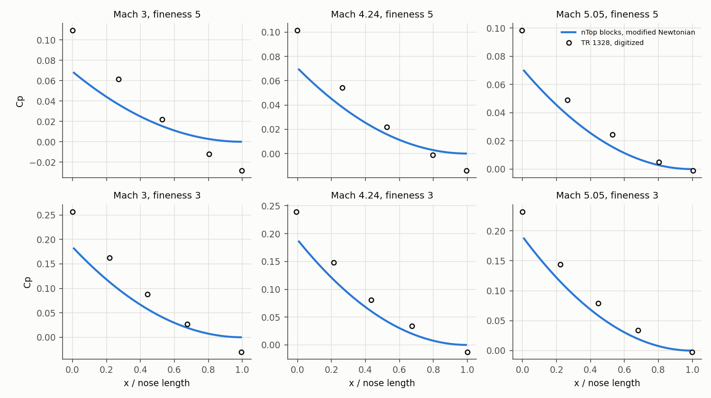
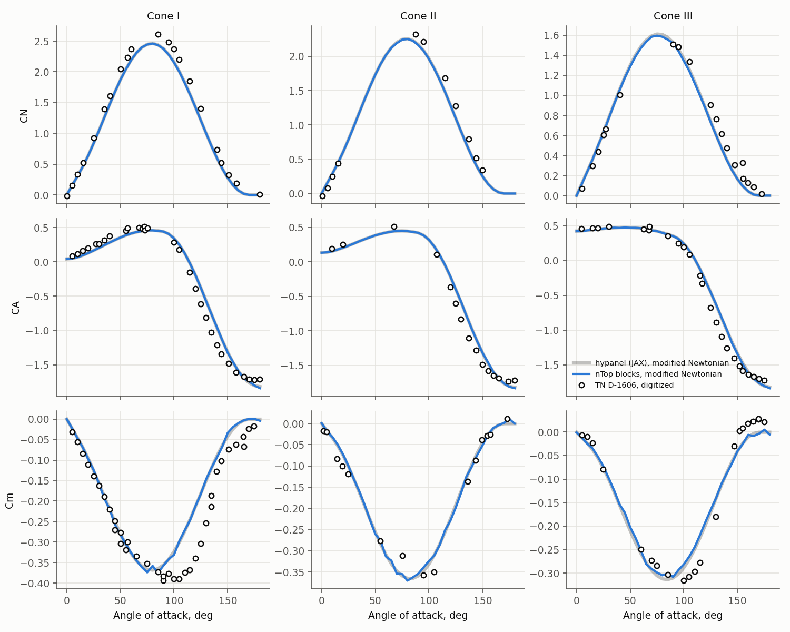
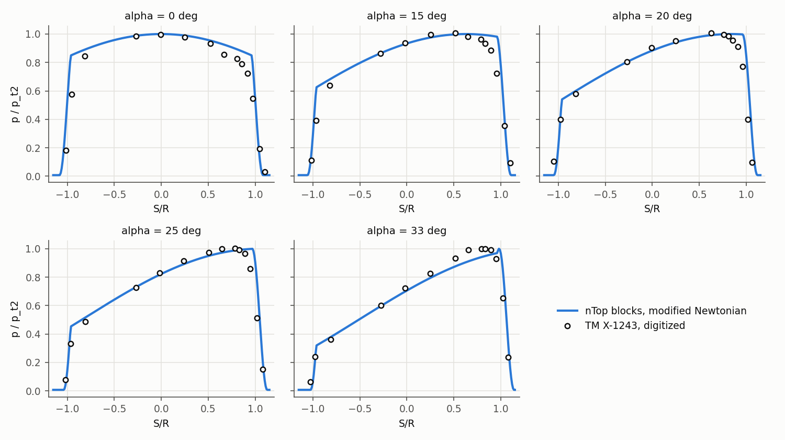

# Validation report: modified Newtonian in nTop blocks

## 1. Modified Newtonian against exact results

Mach 8, gamma 1.4. Every body is built in nTop: primitives, booleans, and exact fields written in nTop's expression language and bounded with Set Bounding Box.

| Check | Exact | nTop | Error |
| --- | --- | --- | --- |
| Cp_max (Rayleigh pitot), from scalar blocks | 1.827354 | 1.827354 | 0.0e+00 |
| Sphere CD, alpha 0 | 0.9137 | 0.9129 | -8.2e-04 |
| Sphere CD, alpha 23 | 0.9137 | 0.9132 | -4.9e-04 |
| Cylinder in crossflow, CD on D x L | 1.2182 | 1.2110 | -5.9e-03 |
| Flat plate (box 100 x 100 x 0.1 mm) CN, alpha 5 to 70 | Cp_max sin^2(alpha) |  | 7.1e-04 largest |
| 15 degree cone, alpha 0 to 60, CA | quadrature |  | 0.0022 largest absolute |
| 15 degree cone, alpha 0 to 60, CN | quadrature |  | 0.0098 largest absolute |

## 2. Against wind-tunnel data, beside hypanel's modified Newtonian

Pressure on tangent ogives, NACA TR 1328, alpha 0 (Cp RMS against the digitized data). The nTop pressure field is evaluated at the same 60 stations on three meridians as hypanel's probes:

| Case | nTop RMS | hypanel RMS | nTop vs exact Newtonian, largest | Spread across meridians |
| --- | --- | --- | --- | --- |
| Mach 3, fineness 5 | 0.0262 | 0.0262 | 2.8e-17 | 4.2e-17 |
| Mach 4.24, fineness 5 | 0.0176 | 0.0176 | 3.5e-17 | 4.2e-17 |
| Mach 5.05, fineness 5 | 0.0142 | 0.0142 | 3.5e-17 | 4.2e-17 |
| Mach 3, fineness 3 | 0.0446 | 0.0446 | 8.3e-17 | 9.7e-17 |
| Mach 4.24, fineness 3 | 0.0305 | 0.0305 | 1.4e-16 | 1.1e-16 |
| Mach 5.05, fineness 3 | 0.0263 | 0.0263 | 1.4e-16 | 9.7e-17 |

Forces on the 9 degree cones of NASA TN D-1606, Mach 6.77, alpha 0 to 180 degrees in 5 degree steps (RMS against the digitized data):

| Cone |  | nTop, to 40 deg | hypanel, to 40 deg | nTop, to 180 deg | hypanel, to 180 deg | Largest difference from hypanel's curve |
| --- | --- | --- | --- | --- | --- | --- |
| I | CN | 0.0669 | 0.0661 | 0.1381 | 0.1359 | 0.0076 |
| I | CA | 0.0654 | 0.0654 | 0.1281 | 0.1280 | 0.0230 |
| I | Cm | 0.0101 | 0.0103 | 0.0544 | 0.0543 | 0.0103 |
| II | CN | 0.0497 | 0.0499 | 0.1195 | 0.1182 | 0.0119 |
| II | CA | 0.0450 | 0.0449 | 0.1420 | 0.1401 | 0.0143 |
| II | Cm | 0.0233 | 0.0218 | 0.0217 | 0.0215 | 0.0108 |
| III | CN | 0.0498 | 0.0522 | 0.1022 | 0.1005 | 0.0233 |
| III | CA | 0.0247 | 0.0241 | 0.1224 | 0.1232 | 0.0251 |
| III | Cm | 0.0102 | 0.0103 | 0.0298 | 0.0282 | 0.0128 |

Apollo command module pitch-plane pressure, NASA TM X-1243, Mach 10.18 (p/p_t2 RMS against the digitized data), and forces beside hypanel's:

| Alpha | Shield RMS | hypanel | All RMS | hypanel | CA | hypanel | CN | hypanel | L/D | hypanel |
| --- | --- | --- | --- | --- | --- | --- | --- | --- | --- | --- |
| 0 | 0.107 | 0.107 | 0.121 | 0.121 | 1.610 | 1.602 | 0.0015 | -0.0001 | 0.001 | -0.000 |
| 15 | 0.091 | 0.091 | 0.098 | 0.098 | 1.504 | 1.502 | 0.0598 | 0.0600 | -0.226 | -0.226 |
| 20 | 0.079 | 0.079 | 0.121 | 0.121 | 1.433 | 1.428 | 0.0777 | 0.0781 | -0.304 | -0.303 |
| 25 | 0.055 | 0.055 | 0.088 | 0.088 | 1.340 | 1.336 | 0.0945 | 0.0945 | -0.383 | -0.383 |
| 33 | 0.045 | 0.045 | 0.072 | 0.072 | 1.158 | 1.160 | 0.1139 | 0.1165 | -0.518 | -0.515 |

## 3. Viscous correction against hypanel's skin-friction formulas

Friction axial force at zero incidence, sea-level freestream, adiabatic wall. The reference integrates hypanel's own `viscous.flat_plate_cf` exactly along the running length with the same Newtonian edge state (`validation/viscous_reference.py`). Plate: 1 m x 0.2 m x 2 mm, CA on its 0.2 m^2 planform. Cone: 15 degrees, 0.5 m long, CA on its base.

| Body | Mach | Boundary layer | nTop CA | Reference CA | Difference |
| --- | --- | --- | --- | --- | --- |
| plate | 3 | Fully Turbulent | 0.002172 | 0.002174 | -0.1% |
| plate | 3 | Laminar | 0.000238 | 0.000239 | -0.5% |
| plate | 8 | Fully Turbulent | 0.000646 | 0.000647 | -0.1% |
| plate | 8 | Laminar | 0.000105 | 0.000105 | -0.5% |
| cone15 | 3 | Fully Turbulent | 0.005221 | 0.005203 | +0.3% |
| cone15 | 3 | Laminar | 0.000468 | 0.000468 | -0.0% |
| cone15 | 8 | Fully Turbulent | 0.003655 | 0.003651 | +0.1% |
| cone15 | 8 | Laminar | 0.000351 | 0.000351 | +0.1% |

**Subsonic block** (Viscous Correction Subsonic Coefficients). Same plate, Mach 0.3 and 0.8, with a uniform Cp of 0 (edge state = freestream) and -0.5 (accelerated edge flow). The reference (`validation/viscous_subsonic_reference.py`) uses hypanel's pitot pressure, which is the isentropic total pressure at or below Mach 1. nTop side: `validation/viscous_subsonic_check.py`, 176 s for the eight rows.

| Body | Mach | Boundary layer | Cp | nTop CA | Reference CA | Difference |
| --- | --- | --- | --- | --- | --- | --- |
| plate | 0.3 | Fully Turbulent | 0 | 0.006584 | 0.006591 | -0.1% |
| plate | 0.3 | Fully Turbulent | -0.5 | 0.009350 | 0.009360 | -0.1% |
| plate | 0.3 | Laminar | 0 | 0.001008 | 0.001013 | -0.5% |
| plate | 0.3 | Laminar | -0.5 | 0.001349 | 0.001356 | -0.5% |
| plate | 0.8 | Fully Turbulent | 0 | 0.005382 | 0.005388 | -0.1% |
| plate | 0.8 | Fully Turbulent | -0.5 | 0.006652 | 0.006660 | -0.1% |
| plate | 0.8 | Laminar | 0 | 0.000613 | 0.000616 | -0.5% |
| plate | 0.8 | Laminar | -0.5 | 0.000751 | 0.000755 | -0.5% |

**On-mesh blocks** (Viscous Correction on Mesh Coefficients and Subsonic on Mesh Coefficients): the same cases with the coefficients summed over surface points instead of integrated. The points are written from the exact geometry, graded toward the leading edge or apex (x = L t^2) with one point per cell at its area centroid (6048 on the plate, 3168 on the cone). nTop side: `validation/viscous_faces_check.py`, 7 s, 6 s and 9 s for the three tables' rows.

| Body | Mach | Boundary layer | Cp | On-mesh CA | Reference CA | On-mesh difference | Integral difference |
| --- | --- | --- | --- | --- | --- | --- | --- |
| plate | 3 | Fully Turbulent | Newtonian | 0.002174 | 0.002174 | -0.0% | -0.1% |
| plate | 3 | Laminar | Newtonian | 0.000238 | 0.000239 | -0.3% | -0.5% |
| plate | 8 | Fully Turbulent | Newtonian | 0.000647 | 0.000647 | -0.0% | -0.1% |
| plate | 8 | Laminar | Newtonian | 0.000105 | 0.000105 | -0.3% | -0.5% |
| cone15 | 3 | Fully Turbulent | Newtonian | 0.005203 | 0.005203 | -0.0% | +0.3% |
| cone15 | 3 | Laminar | Newtonian | 0.000468 | 0.000468 | -0.0% | -0.0% |
| cone15 | 8 | Fully Turbulent | Newtonian | 0.003651 | 0.003651 | -0.0% | +0.1% |
| cone15 | 8 | Laminar | Newtonian | 0.000351 | 0.000351 | -0.0% | +0.1% |
| plate | 0.3 | Fully Turbulent | 0 | 0.006591 | 0.006591 | -0.0% | -0.1% |
| plate | 0.3 | Fully Turbulent | -0.5 | 0.009359 | 0.009360 | -0.0% | -0.1% |
| plate | 0.3 | Laminar | 0 | 0.001010 | 0.001013 | -0.3% | -0.5% |
| plate | 0.3 | Laminar | -0.5 | 0.001352 | 0.001356 | -0.3% | -0.5% |
| plate | 0.8 | Fully Turbulent | 0 | 0.005387 | 0.005388 | -0.0% | -0.1% |
| plate | 0.8 | Fully Turbulent | -0.5 | 0.006659 | 0.006660 | -0.0% | -0.1% |
| plate | 0.8 | Laminar | 0 | 0.000614 | 0.000616 | -0.3% | -0.5% |
| plate | 0.8 | Laminar | -0.5 | 0.000752 | 0.000755 | -0.3% | -0.5% |

## 4. Sweeps by list processing

`examples/Sweeps.ntop` (written and run by `examples/sweeps.py`, 606 s for every sweep below): the 15 degree, 0.5 m cone at Mach 8 with a Sequence from Bounds of angles of attack into the single-coefficient blocks, a list of Mach numbers at 10 degrees, and the Pressure block's list of Cp fields paired with the angles in the viscous block.

| Alpha, deg | CN | CA | Pressure CD | Friction CD (turbulent) | Total CD |
| --- | --- | --- | --- | --- | --- |
| 0 | 0.0007 | 0.1220 | 0.1220 | 0.00365 | 0.1257 |
| 5 | 0.1468 | 0.1285 | 0.1408 | 0.00361 | 0.1444 |
| 10 | 0.2909 | 0.1438 | 0.1921 | 0.00346 | 0.1956 |
| 15 | 0.4255 | 0.1710 | 0.2753 | 0.00337 | 0.2787 |
| 20 | 0.5530 | 0.2057 | 0.3825 | 0.00329 | 0.3858 |
| 25 | 0.6829 | 0.2434 | 0.5092 | 0.00321 | 0.5124 |
| 30 | 0.8139 | 0.2831 | 0.6521 | 0.00306 | 0.6551 |
| 35 | 0.9404 | 0.3205 | 0.8020 | 0.00292 | 0.8049 |
| 40 | 1.0562 | 0.3576 | 0.9529 | 0.00281 | 0.9557 |

| Mach | 2 | 3 | 5 | 8 | 12 | 20 |
| --- | --- | --- | --- | --- | --- | --- |
| CD at 10 deg | 0.1741 | 0.1848 | 0.1901 | 0.1921 | 0.1929 | 0.1933 |
