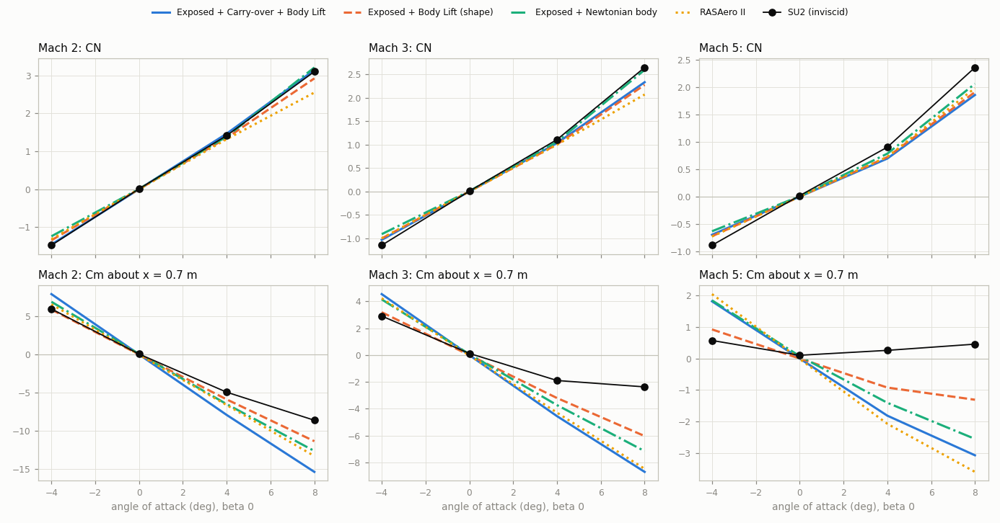

# A noncircular body: the trapezoid-section rocket against SU2

The hobby rocket of `validation/rasaero`, with its body section changed from a 54 mm circle to a rounded trapezoid.
The trapezoid is 70 mm wide at the bottom, 30 mm at the top and 48 mm high, with 6 mm corners and an area of 2367 mm²,
3% more than the circle. Along the body it scales with the same 5:1 tangent-ogive radius, and the four fins are the same
(`geometry.py`). The body is an nTop expression field, so nothing is faceted.

The reference is inviscid SU2 8.2 (`cfd.py`, hypanel's SU2 chain):
- a tetrahedral mesh built in nTop (3 mm tolerance and edge, 434k nodes, 99k wall faces);
- Mach 2, 3 and 5 at alpha −4, 0, 4 and 8, beta 0;
- 180 iterations (CL and CMy steady to 1e-4 from iteration 100), forces from x < 1200 mm only.

Coefficients use the round rocket's Sref and reference length, with moments about x = 0.7 m.

On the nTop_vsp side (`build.py`), one notebook runs:
- the OpenVSP model: the body as a Fuselage in Set None, and the fins Thin, Extend Into Body, Exposed Strip +
  Carry-over;
- VSPAERO with a fixed wake;
- Body Lift (slender body + crossflow);
- Modified Newtonian on Mesh on the body alone;
- RASAero II.

All of it ran in 72 to 133 s.

**RASAero II has no noncircular body.** Its block fits a round body to the OpenVSP model, and takes the four fins'
mean planform where they differ: a 54.8 mm diameter here, with root chords from 150 to 159 mm. Its row is that round
stand-in.

## Results

| Mach, alpha | SU2: CN, x_cp (mm), Cm | Exposed + Carry-over + Body Lift | Exposed + Body Lift | Exposed + Newtonian body | RASAero II |
|---|---|---|---|---|---|
| 2, −4 | −1.482, 917, +5.96 | −1%, +75 mm, Cm +7.90 | −13%, +55 mm, Cm +6.49 | −16%, +82 mm, Cm +6.90 | −11%, +51 mm, Cm +6.56 |
| 2, +4 | 1.415, 889, −4.94 | +4%, +103 mm, Cm −7.92 | −9%, +83 mm, Cm −6.50 | −2%, +64 mm, Cm −6.51 | −7%, +83 mm, Cm −6.63 |
| 2, +8 | 3.104, 850, −8.61 | +1%, +114 mm, Cm −15.37 | −10%, +92 mm, Cm −12.58 | +4%, +63 mm, Cm −12.64 | −18%, +132 mm, Cm −13.30 |
| 3, −4 | −1.147, 837, +2.91 | −10%, +101 mm, Cm +4.55 | −18%, +81 mm, Cm +3.81 | −21%, +109 mm, Cm +4.15 | −13%, +92 mm, Cm +4.24 |
| 3, +4 | 1.107, 792, −1.89 | −7%, +146 mm, Cm −4.55 | −15%, +126 mm, Cm −3.81 | −4%, +98 mm, Cm −3.72 | −10%, +140 mm, Cm −4.28 |
| 3, +8 | 2.644, 748, −2.37 | −12%, +153 mm, Cm −8.70 | −19%, +133 mm, Cm −7.25 | −2%, +101 mm, Cm −7.16 | −22%, +173 mm, Cm −8.48 |
| 5, −4 | −0.890, 735, +0.57 | −22%, +106 mm, Cm +1.81 | −25%, +90 mm, Cm +1.54 | −29%, +123 mm, Cm +1.85 | −18%, +117 mm, Cm +2.04 |
| 5, +4 | 0.906, 685, +0.26 | −23%, +156 mm, Cm −1.81 | −27%, +140 mm, Cm −1.54 | −13%, +112 mm, Cm −1.41 | −20%, +169 mm, Cm −2.07 |
| 5, +8 | 2.366, 690, +0.46 | −21%, +100 mm, Cm −3.07 | −24%, +86 mm, Cm −2.53 | −13%, +77 mm, Cm −2.55 | −16%, +108 mm, Cm −3.60 |

(CN error, centre-of-pressure error positive aft, and each combination's own Cm.)

By region (SU2 split at the fin roots by the body's own field; nTop_vsp by source):

| Mach, alpha | SU2 body ahead of fins: CN (x_cp, m) | Body Lift | Body Lift (shape) | Newtonian body | SU2 tube at fins / TR 1307 carry-over | SU2 fins / VSPAERO exposed fins |
|---|---|---|---|---|---|---|
| 2, −4 | −0.410 (0.341) | −0.273 (0.393) | −0.334 (0.349) | −0.228 (0.428) | −0.112 / −0.172 | −0.960 / −1.016 |
| 2, +4 | 0.444 (0.337) | 0.273 (0.393) | 0.334 (0.349) | 0.369 (0.473) | 0.105 / 0.173 | 0.866 / 1.020 |
| 2, +8 | 1.226 (0.403) | 0.790 (0.471) | 0.909 (0.429) | 1.197 (0.552) | 0.215 / 0.341 | 1.663 / 2.015 |
| 3, −4 | −0.438 (0.346) | −0.274 (0.393) | −0.334 (0.349) | −0.242 (0.428) | −0.041 / −0.089 | −0.669 / −0.669 |
| 3, +4 | 0.477 (0.331) | 0.274 (0.393) | 0.334 (0.349) | 0.391 (0.473) | 0.038 / 0.089 | 0.592 / 0.669 |
| 3, +8 | 1.450 (0.425) | 0.830 (0.480) | 0.949 (0.438) | 1.269 (0.552) | 0.117 / 0.176 | 1.077 / 1.325 |
| 5, −4 | −0.478 (0.388) | −0.280 (0.399) | −0.340 (0.354) | −0.249 (0.428) | −0.020 / −0.033 | −0.392 / −0.384 |
| 5, +4 | 0.533 (0.367) | 0.280 (0.399) | 0.340 (0.354) | 0.403 (0.473) | 0.026 / 0.033 | 0.347 / 0.384 |
| 5, +8 | 1.585 (0.470) | 1.036 (0.512) | 1.155 (0.474) | 1.307 (0.552) | 0.163 / 0.066 | 0.617 / 0.760 |

## What goes wrong, and why

**Every combination is wrong about stability on this body, and so is RASAero II's round stand-in.**
- SU2's centre of pressure moves forward with Mach number: 850–917 mm at Mach 2, 748–837 mm at Mach 3 and 685–735 mm
  at Mach 5. At Mach 5, alpha 4 and 8, it is ahead of the 0.7 m moment point, so the rocket is statically unstable
  about it (Cm +0.26 and +0.46).
- Every method here puts the centre of pressure 51 to 173 mm (1 to 3 body diameters) aft of SU2's, and predicts
  Cm −1.4 to −3.6 there.
- Total CN is closer, within −29% to +4%, partly by cancellation.

By region:
* **The body ahead of the fins** lifts 1.5 to 1.9 times what Body Lift gives. Body Lift puts it near the right place
  (centre of pressure 0.39 to 0.51 m against SU2's 0.33 to 0.47 m). Its slender-body term,
  dCN/dx = (dS/dx)/Sref · sin 2α cos(α/2), sees only cross-section area, so it treats the body as its equivalent round
  tube. In slender-body theory the lift follows the section's crossflow apparent mass instead. For a section 70 mm wide
  that is about π·35² = 3848 mm², against an area of 2367 mm²: a ratio of about 1.6, close to the shortfall. The
  Newtonian body gets 80 to 90% of the force, but centres it 80 to 140 mm aft of SU2's: impact pressure has no
  slender-body nose loading.
* **The fins** from VSPAERO are within 6% of SU2's at alpha −4. At +4 they are 11 to 18% high, and at +8, 21 to 23%.
  The flat-bottomed body changes the crossflow at the side fins (on the round body they were within 10%). VSPAERO
  solves the fins without the body, so it cannot see this.
* **TR 1307's carry-over** is 1.3 to 2.3 times SU2's lift on the tube between the fins (0.089 against 0.038 at Mach 3,
  alpha 4), except at Mach 5, alpha 8 (0.066 against 0.163). Its planar model knows only the body's width there (52.8
  and 48.7 mm), not its shape.
* **At zero alpha** the asymmetric body lifts and pitches a little (SU2 CN 0.007 to 0.019, Cm +0.05 to +0.13). The
  Newtonian body gives CN 0.006 to 0.007, Cm +0.07 to +0.08. Nothing else sees it.

## Body Lift with section shape

Body Lift now has **Potential Lift: Slender Body (Section Shape)** (README). It uses each OpenVSP section's crossflow
apparent mass, from a 2D potential-flow solve, in place of its area. On this section the vertical-crossflow apparent
mass is 1.37 times the area, and the horizontal one 1.00 (it equals the area on the round rocket, to 0.02%).

| Mach, alpha | SU2 x_cp (mm) | Exposed + Body Lift (shape) | Exposed + Carry-over + Body Lift (shape) | Exposed + Body Lift (area) |
|---|---|---|---|---|
| 2, −4 | 917 | −9%, +18 mm | +3%, +41 mm | −13%, +55 mm |
| 2, +4 | 889 | −4%, +46 mm | +8%, +70 mm | −9%, +83 mm |
| 2, +8 | 850 | −6%, +60 mm | +5%, +84 mm | −10%, +92 mm |
| 3, −4 | 837 | −13%, +35 mm | −5%, +57 mm | −18%, +81 mm |
| 3, +4 | 792 | −9%, +80 mm | −1%, +102 mm | −15%, +126 mm |
| 3, +8 | 748 | −14%, +95 mm | −7%, +117 mm | −19%, +133 mm |
| 5, −4 | 735 | −19%, +34 mm | −15%, +51 mm | −25%, +90 mm |
| 5, +4 | 685 | −20%, +84 mm | −16%, +101 mm | −27%, +140 mm |
| 5, +8 | 690 | −19%, +47 mm | −16%, +61 mm | −24%, +86 mm |

(CN error, centre-of-pressure error positive aft.)

The section shape roughly halves the centre-of-pressure error: +18 to +95 mm, against +55 to +140 with the area.
- **Forebody:** its lift rises by a fifth (0.273 → 0.334 at alpha 4), and its centre of pressure moves forward to
  0.35 m (SU2: 0.33 to 0.37 m).
- **Gap to SU2:** the forebody is still 25 to 36% under. SU2's trapezoid nose lifts 1.7 times the round nose's,
  against slender-body theory's 1.37. Its constant-section tube also carries inviscid lift (0.17 at Mach 2, alpha 4),
  where slender-body theory gives none. Both are beyond a linear slender-body term.
- **Carry-over:** on this body, adding TR 1307 makes the centre of pressure worse (+41 to +117 mm), since its
  carry-over is 1.3 to 2.3 times SU2's here.
- **Stability:** no combination finds Mach 5's instability about 0.7 m. The nearest, Exposed + Body Lift (shape),
  still puts the centre of pressure 47 to 84 mm aft there.

The fin error remains: VSPAERO, solving the fins without the body, is 11 to 23% high at positive alpha.

Body Lift's numbers here are after a fix found during this work. OpenVSP's last surface rings lie in the base plane,
sweeping across the flat base cap. Body Lift had kept the first of them, a partial outline 18% smaller than the tube,
so the body seemed to shrink at its last station, with a spurious negative lift at the base (about −0.017 CN at alpha 4).
Cap rings are now left out.

## Other setups tried

* **Fuselage in VSPAERO's Thin (vortex-lattice) set.** VSPAERO lattices the whole closed body surface, with no camber
  plates. The first case took 1500 GMRES iterations and 20 minutes without converging, and returned CL ≈ 12,000 (as
  the README's X-59 NaN). Stopped.
* **The body as a horizontal vortex-lattice plate** (`build.py plate`). The plate is the body cut by a 2 mm slab in the
  fins' plane, an OpenVSP Wing with x-z symmetry as wide as the body at z = 0, so it stops 1 mm short of the side fins'
  roots. The fins run from the body surface, not extended, so they don't overlap it. This was 40 to 67% low in CN with
  the centre of pressure 200 to 450 mm aft. The plate carries no more than Body Lift, about 0.25 at Mach 2, alpha 4.
  The fins keep a root loss across the 1 mm gap (strip Cz 0.058 at the root against 0.15 mid-span).
* **Extended fins, Whole Wing** (the inboard strips stand for the body): CN −8% to +32%, centre of pressure 85 to 200
  mm aft.

## Files

`geometry.py` (body field, fins), `build.py` (the nTop notebook: model, VSPAERO, Body Lift, RASAero II, Newtonian;
`build.py plate` for the plate variant), `cfd.py` (mesh, SU2 runs, `results/su2.json`), `compare.py`
(`results/compare.json`, `results/compare.txt` with every combination), `plots.py` (`results/cn_cm.png`). Runs:
`runs/noncircular/`.
