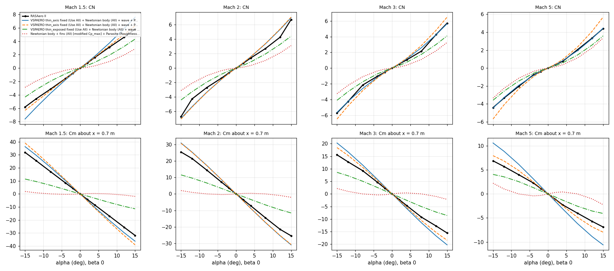
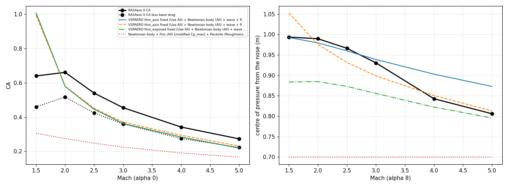
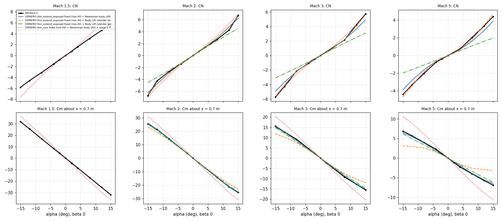
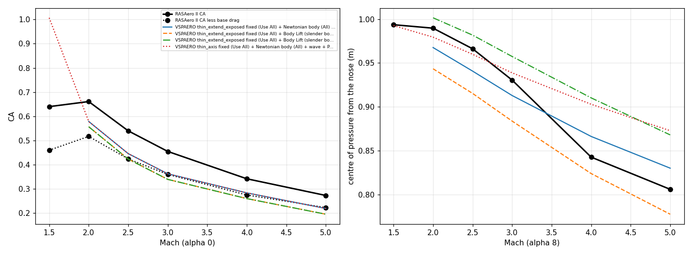

# nTop_vsp against RASAero II on the hobby rocket

Which combination of nTop_vsp settings best reproduces RASAero II's forces and moments on hypanel's hobby rocket, over
Mach 1.5 to 5, angle of attack -15 to 15 degrees and sideslip -4 to 4 degrees.

## The vehicle and the reference

* **Rocket**: hypanel's comparison rocket (`hypanel/validation/rocket/design.py`, the file that also wrote the RASAero II
  design `hobby_rocket.CDX1`): 5:1 tangent-ogive nose, 54 mm body 1.2 m long, four 4 mm hexagonal-section fins
  (160 mm root, 60 mm tip, 70 mm span) on the +y, +z, -y and -z sides. Built as nTop implicits in `rocket.py`.
* **RASAero II 1.0.2.0**, smooth, all turbulent, sea level, power off; Run Test files for alpha 0, 1, 2, 4, 6, 8 (from
  hypanel) and 10, 12, 14, 15, 16 (run for this study with `hypanel/validation/rocket/rasaero_driver/run_test.ps1`) in
  `rasaero_runs/`. RASAero II is axisymmetric, so at (alpha, beta) its normal force is taken at the total angle
  acos(cos a cos b), along the crossflow, with its center of pressure on the axis (`rasaero_ref.py`).
* **Grid** (the same for every source): Mach 1.5, 2, 2.5, 3, 4, 5 at sea level x alpha -15, -12, -8, -4, -2, 0, 2, 4, 8,
  12, 15 x beta -4, -2, 0, 2, 4 (330 conditions). Sref = pi d^2/4, every moment over Sref d, about x = 0.7 m on the axis.
* **Score**: at each Mach number, over its 55 conditions, the RMS error of CN, CY, Cm and Cn over the RMS of RASAero's
  values, and of CA over RASAero's mean CA; the score is the mean of the five, averaged over Mach. Cl is reported only
  (RASAero gives none; every combination's is below 0.004).
* **Base drag**: RASAero's CA includes base drag (0.180 at Mach 1.5, 0.144 at 2, 0.116 at 2.5, 0.095 at 3, 0.067 at 4,
  0.050 at 5). No nTop_vsp source computes base drag (Newtonian puts no pressure on leeward faces, VSPAERO and the area
  rule have none), so every combination is scored twice: against RASAero's CA, and against its CA less base drag
  ("no-base"). The second says which methods are right about what they model.

## What was run

All sources enter as the Aero Database does it (`vsp_ntop.run_database.Contribution`, Use = All / Drag only / All but
drag), from the same drivers the blocks run (`sweep.py` runs them on settings files written by the blocks in
`build_models.py`).

| Source | Settings studied |
|---|---|
| VSPAERO | fins Thin from the body surface (`thin_exposed`) or extended through the body to the axis (`thin_axis`); fins Thick (`thick_exposed`); body Thick with thin or thick fins (probe only, see below); fixed wake, relaxed wake with 3, 5, 8 iterations |
| Modified Newtonian on Mesh | whole rocket, body alone, exposed fins alone; Cp_max Modified (Rayleigh pitot), Classical (2), or fitted (a User Defined Cp Max Field constant per component and Mach number) |
| Wave Drag | 30 slices, 30 rotation sections (slice study below) |
| Parasite Drag | turbulent Cf "Schlichting Compressible" (the block's default) or "Roughness Schlichting Avg Compressible" |

## Result

**Best without fitting anything** (rank 17 of 927 combinations; the 16 above it fit Cp_max and gain at most 0.024):

| Part | Setting | Contribution (Use) |
|---|---|---|
| Fins | OpenVSP Wing, **Thin** (vortex lattice), **extended through the body to the axis** | VSPAERO, **All** |
| Body | OpenVSP Fuselage in **no** VSPAERO set; **Modified Newtonian on Mesh** of the body alone, Cp_max **Modified** | Coefficients, **All** |
| Pressure drag | OpenVSP **Wave Drag** of the whole model (30 slices, 30 rotation sections) | Wave, drag along the freestream |
| Friction | OpenVSP **Parasite Drag**, turbulent Cf **Roughness Schlichting Avg Compressible** | Parasite, drag along the freestream |
| Wake | **Fixed** (relaxed: below) | |

Normalised errors (RMS error over RMS of RASAero's values; CA over its mean), per Mach number:

| Mach | CA | CA, no-base | CN | CY | Cm | Cn | score |
|---|---|---|---|---|---|---|---|
| 1.5 | 0.535 | 1.112 | 0.277 | 0.218 | 0.157 | 0.186 | 0.275 |
| 2 | 0.133 | 0.102 | 0.140 | 0.157 | 0.203 | 0.207 | 0.168 |
| 2.5 | 0.172 | 0.047 | 0.073 | 0.123 | 0.254 | 0.240 | 0.172 |
| 3 | 0.192 | 0.015 | 0.051 | 0.095 | 0.296 | 0.271 | 0.181 |
| 4 | 0.148 | 0.057 | 0.024 | 0.072 | 0.416 | 0.373 | 0.206 |
| 5 | 0.158 | 0.045 | 0.024 | 0.037 | 0.539 | 0.485 | 0.249 |
| mean | 0.223 | 0.230 | 0.098 | 0.117 | 0.311 | 0.293 | 0.208 |

(In the plots: solid blue the combination above; orange dashed the same with a fitted body Cp_max; green the fins only
from the body surface; red the all-Newtonian rocket.)

* **Normal and side force** within 2 to 14% from Mach 2 to 5 (28% at 1.5), over the whole alpha and beta range. The
  vortex lattice gives the linear part (fins plus the body's carry-over, because the fins run through the body), the
  Newtonian body the non-linear crossflow part at high alpha (Newtonian goes as sin^2 alpha, like viscous crossflow).
* **Axial force**: from Mach 2 to 5, CA matches RASAero's CA less its base drag within 1.5 to 10%; the gap to RASAero's
  CA is its base drag, which nothing in nTop_vsp models. At Mach 1.5, Wave Drag over-predicts (0.73 vs RASAero's
  0.15 of nose and fin wave drag) because of the step the blunt base puts in the area distribution; Wave Drag does not
  converge with slices there (Mach 1.5: 0.29, 0.60, 0.73, 0.77, 0.83 at 10, 20, 30, 40, 60 slices; Mach 3: 0.11 to 0.20).
  Below Mach 2, Newtonian fin drag (Use: Drag only, Cp_max Modified) in place of Wave Drag gives CA no-base 0.53 instead
  of 1.11 and the Mach-windowed combination (that below Mach 2, Wave Drag from Mach 2: two contributions with Mach Min /
  Mach Max) scores 0.179 no-base over the whole range.
* **Moments** are the weak part: the centre of pressure is right to Mach 3 and moves aft of RASAero's above it (x_cp
  0.90 vs 0.84 m at Mach 4, 0.87 vs 0.81 at 5, alpha 8): RASAero's forward shift with Mach (nose lift growing,
  fin lift falling) is not reproduced by the vortex lattice, and Newtonian on the nose adds too little at small angles.
  Errors in Cm grow from 16% at Mach 1.5 to 54% at Mach 5.

**Cp_max.** For the body term, Modified and Classical score alike (0.208 vs 0.206; Classical trades CN for Cm). A
fitted Cp_max per Mach number (what a User Defined Cp Max Field of that constant gives) improves the mean to 0.184,
mostly Cm: the fitted body Cp_max is 0.56, 1.72, 2.19, 2.40, 2.60, 2.73 at Mach 1.5, 2, 2.5, 3, 4, 5, i.e. close to
Modified (1.66 to 1.81) at Mach 2 and rising above Classical by Mach 4. Fitted fin-drag Cp_max values were unphysical
(12 at Mach 1.5, standing in for linear-theory wedge drag that Newtonian's sin^2 cannot give).

**What did not work:**

| Combination | mean score | why |
|---|---|---|
| Fins Thin from the body surface (`thin_exposed`), same other parts | 0.352 | no body carry-over lift: CN error 28%, Cm 49%; centre of pressure about 0.1 m forward of RASAero's at Mach 1.5 to 2 |
| Newtonian alone (body + fins, Modified) | 0.705 | CN goes as sin^2 alpha: almost nothing at small angles |
| Newtonian alone, fitted Cp_max | 0.333 | still sin^2; moments 40 to 60% off |
| Fins Thick (`thick_exposed`, panel method) | 1.649 | at Mach 1.5 nonsense that passes the convergence check (CA 23, negative lift at alpha 8); from Mach 2 sensible but only 55 to 65% of the thin-fin lift, and its fin drag 70% of RASAero's fin wave drag (0.18 vs 0.23 at Mach 2, 0.094 vs 0.138 at 3) |
| Body Thick (panel method) | not run in full | VSPAERO's linear solver stalls supersonic: on the body (Thick, 7,850 panels) with thin fins at Mach 2, alpha 0, 4, 8, every case ran to GMRES's 1,500-iteration cap (residual reduction -1.5 of the -3 target, about 9 minutes per case on 16 threads) and the results are nonsense: CA -0.48 to -9.6, CN 0.20 at alpha 0 and -2.0 at alpha 8 (thin fins to the axis: CN 0, 1.28, 2.54). The thick body with thick fins was not finished |
| VSPAERO with Use **All but drag** + any drag source | slightly worse | VSPAERO's thin surfaces give a pure normal force; "All but drag" removes its projection on the freestream and leaves a spurious axial force -CN sin(a) cos(a) (up to -1.1 at 15 degrees), which only a drag source that adds it back can repair |
| Parasite Drag with its default Cf (Schlichting Compressible) | CA better *with* base drag, worse without | OpenVSP 3.56's "Schlichting Compressible" has no Mach correction (body Cf 0.00218 at Mach 3 = the incompressible 0.455/(log Re)^2.58); its 1.8 to 2.8x too-high friction offsets the missing base drag by accident |

**Wake.** On the recommended model (thin fins to the axis), relaxed wakes at Mach 1.5, 3 and 5 change no force or
moment by more than 0.5% of its largest value from the fixed wake (`wake_compare.py`):

| Wake | largest change (CN, CY, Cm, Cn) | run time vs fixed | cases passing the convergence check |
|---|---|---|---|
| relaxed, 3 iterations | 0.05 to 0.5% | 2.4x | 51 of 55 at each Mach |
| relaxed, 5 iterations | 0.01 to 0.4% | 3.5 to 3.9x | 51 to 55 of 55 |
| relaxed, 8 iterations | 0 to 0.4% | 3.7 to 5.6x | 52 to 55 of 55 |

So the wake model and the number of wake iterations do not matter here (supersonic, the wake trails behind the
fins' Mach cones and barely acts back on them); use the fixed wake, which is also the one that never fails the
wake-change check.

## Against CFD: who is right about the moments, and why fins to the axis works

hypanel has inviscid SU2 8.2 runs of the same rocket (`hypanel/validation/rocket/su2`, data in
`hypanel/validation/data/su2_inviscid.json`): five inside this study's range (beta 0), with the normal force split
along the length, plus the body alone at three. `su2_compare.py` puts them beside RASAero II and the nTop_vsp pieces
(VSPAERO's own strip loads split the fins-to-axis lift into the strips inside the body radius and the exposed ones).

| Mach, alpha | SU2 CN | RASAero CN (potential + viscous) | SU2 x_cp | RASAero x_cp | recommended combination: CN, x_cp |
|---|---|---|---|---|---|
| 2, 2 | 0.680 | 0.679 (0.650 + 0.029) | 1.014 | 0.987 | 0.731, 1.023 |
| 3, 4 | 1.022 | 1.044 (0.996 + 0.049) | 0.938 | 0.940 | 1.150, 0.973 |
| 4, 4 | 0.834 | 0.853 (0.829 + 0.024) | 0.865 | 0.901 | 0.947, 0.937 |
| 5, 4 | 0.750 | 0.757 (0.733 + 0.024) | 0.808 | 0.862 | 0.818, 0.906 |
| 5, 8 | 1.976 | 2.040 (1.466 + 0.574) | 0.788 | 0.806 | 1.900, 0.875 |

**The moments.** SU2 and RASAero agree on the total normal force (within 3%) and on the centre of pressure up to
Mach 3, but from Mach 4 RASAero's centre of pressure is 36 to 54 mm (0.7 to 1.0 diameters) aft of SU2's at 4 degrees (18 mm at Mach 5 and 8 degrees). At these
small angles RASAero's viscous crossflow term is 3 to 5% of CN, so the difference is in the potential (pressure) part,
which is what an Euler solution gets right; SU2 is the better reference there. RASAero II is a component buildup:
nose lift from supersonic body theory, fin lift from thin-airfoil theory with body-fin interference factors, and
body lift beyond that only as viscous crossflow. What it cannot have is what SU2 shows growing with Mach: lift on the
cylinder behind the shoulder (mid-tube CN 0.009 at Mach 3, 0.066 at Mach 5, 0.504 at Mach 5 and alpha 8). hypanel's
report traced this to the crossflow relief length, about 3 beta R behind the shoulder (140 mm at Mach 2, 400 mm at
Mach 5), over which the nose's lifting pressure pattern dies out. Holding the same total with no mid-tube lift, a
buildup must put more on the fins: placing RASAero's lift at SU2's nose and fin centroids (an estimate; RASAero does
not list its parts) gives about 0.84 on the fins at Mach 3 (SU2 0.80) and 0.55 at Mach 5 (SU2 0.46). At Mach 5 and
alpha 8 RASAero's potential CN is 26% below SU2's and its viscous crossflow (0.574) makes up the difference, so its
total matches there by compensation.

**Fins through the body to the axis: half right.** Split by VSPAERO's strip loads, at every SU2 condition:

| Mach, alpha | SU2 fins | VLM fins to axis, exposed strips | VLM fins from the body surface | SU2 tube between the fins (carry-over) | VLM fins to axis, strips inside the body |
|---|---|---|---|---|---|
| 2, 2 | 0.491 | 0.490 | 0.289 | 0.103 | 0.154 |
| 3, 4 | 0.698 | 0.674 | 0.473 | 0.104 | 0.226 |
| 4, 4 | 0.527 | 0.506 | 0.381 | 0.058 | 0.187 |
| 5, 4 | 0.427 | 0.402 | 0.320 | 0.035 | 0.160 |
| 5, 8 | 0.835 | 0.796 | 0.633 | 0.138 | 0.316 |

* The **exposed fins' own lift** is right with the fins run to the axis: within 0 to 6% of SU2's at every condition.
  Fins that start at the body surface have a free root edge, so they lose lift there as at a tip, and miss the body's
  upwash; SU2's fins carry 1.3 to 1.7 times their lift (that ratio is the wing-body interference factor K_W(B)).
  Continuing the panels to the axis removes the root loss, which is the slender-body picture of a wing-body, so this
  part is not an accident.
* The **carry-over** is the accident. The strips inside the body carry 24 to 28% of the lift (it barely changes with
  Mach), 1.5 times SU2's carry-over at Mach 2 and 4.6 times at Mach 5. SU2's carry-over falls with Mach, as TR 1307's
  K_B(W) does (hypanel's report, section 6.6); a vortex lattice through the body cannot know the body is there.
* The **body** term is the other half. Against SU2 on the body alone, Newtonian gets the body's total CN about right
  at small angles (0.087 vs 0.088 at Mach 2 and 2 degrees; 0.249 vs 0.22 at Mach 3 and 4 degrees) but places it far
  aft (x_cp 0.33 to 0.43 m against SU2's 0.16 to 0.23 m): its sin^2 pressure is spread along the whole tube, while the
  real linear lift sits on the nose. At Mach 5 and 8 degrees it is 28% low (0.79 vs 1.10).
* So the recommended combination over-predicts CN against SU2 by 7 to 14% at 2 to 4 degrees (the excess carry-over) and
  puts the centre of pressure 35 to 100 mm aft of SU2's from Mach 3 up, further aft than RASAero's. Its good score
  against RASAero comes partly from RASAero's own aft bias at Mach 4 to 5.

What SU2 points to instead: exposed-fin lift from the fins-to-axis vortex lattice (scaling that contribution by
0.72 to 0.76 removes the inside strips, near enough since the share barely varies), a carry-over that falls with Mach
(K_B(W) about 0.2 of the fin lift at Mach 2 to 0.08 at Mach 5, as in TR 1307), and a body term with its linear lift on
the nose. With just the first change, the centre of pressure moves to 1.003, 0.936, 0.854 m at Mach 2, 3, 5 and 4
degrees (SU2 1.014, 0.938, 0.808) and CN drops 10 to 15% below SU2's, which the missing carry-over and nose lift would
restore. None of this is a block yet; it is what the CFD says the buildup is missing. The comparison has five SU2
conditions, all at 8 degrees or less and beta 0, and SU2 here is inviscid.

## Round 2: extended fins with exposed-strip accounting, a nose (body) lift block, RASAero II as a block

New in nTop_vsp for this round (see the README): **OpenVSP Wing (VSP)** inputs **Extend Into Body** (the wing continues
inboard to the plane through the origin normal to its span axis, extrapolating the first section) and **Force
Accounting** (Whole Wing, or Exposed Strip: the VSPAERO driver takes the inboard strips' forces and moments off every
case, from VSPAERO's spanwise loads); **Body Lift (VSP)** (slender-body potential lift from the OpenVSP fuselage's own
area distribution, plus optional Allen-Perkins/Jorgensen viscous crossflow); **RASAero II (VSP)** and **RASAero
Contribution (VSP)**.

**VSPAERO with the fins extended exactly to the axis fails at Mach 1.5** (every case non-finite; Mach 2 to 5 converge):
the four fins then meet on the axis as two intersecting wings, which VSPAERO cannot solve there (the crossing-thin-surface
limitation in the README). So this round is scored over Mach 2 to 5. Meeting on the axis, opposite fins also become one
continuous wing (two trailing-edge wakes instead of four); the hand-made fins-to-axis model of round 1 stopped 0.9 mm
short, kept a root vortex at each fin and had 17% less lift.

Mach 2 to 5, against RASAero II (CA less base drag), mean normalised error:

| Fins (VSPAERO thin) | Body | Pressure drag, friction | score | CA | CN | CY | Cm | Cn |
|---|---|---|---|---|---|---|---|---|
| **extended, Exposed Strip** | **Newtonian body, Modified** | Wave, Parasite (Cf 19) | **0.076** | 0.053 | 0.120 | 0.099 | 0.053 | 0.054 |
| extended, Exposed Strip | Newtonian body, Classical | same | 0.075 | 0.070 | 0.084 | 0.081 | 0.085 | 0.056 |
| extended, Exposed Strip | Body Lift, slender body + crossflow | same | 0.130 | 0.102 | 0.059 | 0.065 | 0.262 | 0.164 |
| extended, Exposed Strip | Body Lift, slender body only | same | 0.202 | 0.102 | 0.420 | 0.332 | 0.085 | 0.074 |
| extended, Whole Wing | Newtonian body, Modified | same | 0.300 | 0.053 | 0.135 | 0.188 | 0.578 | 0.544 |
| round 1: fins to the axis with a gap, whole | Newtonian body, Modified | same | 0.174 | 0.053 | 0.062 | 0.097 | 0.342 | 0.315 |

(Blue: extended fins, Exposed Strip, Newtonian body; orange: the same with Body Lift, slender body + crossflow; green:
Body Lift, slender body only; red: round 1's recommendation. The extended-fin curves start at Mach 2.)

The best fitted-Cp_max combination scores 0.073: fitting buys nothing here. With RASAero's base drag in the CA target
the same combination scores 0.097 (CA 0.160).

Against SU2 (`su2_compare.py`; CN, and x_cp in metres from the nose):

| Mach, alpha | SU2 | RASAero II | Exposed Strip + Newtonian body | Exposed Strip + Body Lift (slender + crossflow) | Extended fins, exposed strips alone / SU2 fins |
|---|---|---|---|---|---|
| 2, 2 | 0.680, 1.014 | 0.679, 0.987 | 0.630, 1.016 | 0.639, 0.994 | 0.543 / 0.491 |
| 3, 4 | 1.022, 0.938 | 1.044, 0.940 | 0.953, 0.950 | 0.954, 0.924 | 0.703 / 0.698 |
| 4, 4 | 0.834, 0.865 | 0.853, 0.901 | 0.766, 0.901 | 0.765, 0.873 | 0.512 / 0.527 |
| 5, 4 | 0.750, 0.808 | 0.757, 0.862 | 0.660, 0.862 | 0.660, 0.829 | 0.403 / 0.427 |
| 5, 8 | 1.976, 0.788 | 2.040, 0.806 | 1.587, 0.832 | 1.779, 0.779 | 0.799 / 0.835 |

* **Exposed Strip fins are the physically right fin term**: within -6% to +11% of SU2's fin lift at every condition.
  Whole Wing adds the inboard strips, 30 to 38% of the lift, which is 2 to 6 times SU2's carry-over: that was the
  accident in round 1, and with the continuous extended wing it is larger still (Cm error 58%).
* **Against RASAero II**, Exposed Strip fins with the Newtonian body match its centre of pressure exactly at Mach 4 and
  5 (0.901, 0.862 m) and its moments within 5%; that is also RASAero's aft bias relative to SU2 (36 to 54 mm).
* **Against SU2**, Exposed Strip fins with Body Lift (slender body + crossflow) are closest: centre of pressure within
  9 to 21 mm at all five conditions, CN 6 to 12% low, which is the carry-over onto the body between the fins (SU2: 0.04
  to 0.14) that nothing here models. Part of that agreement is borrowed: SU2 is inviscid, and the viscous crossflow
  stands in for SU2's inviscid lift on the tube behind the shoulder; the slender-body nose alone carries 20 to 25% less
  than SU2's nose (0.067 vs 0.081, 0.133 vs 0.173).
* **The nose lift block on its own** (slender body, no crossflow) gets the moments (Cm 8.5%) but not the force: CN 42%
  low against RASAero, since RASAero's body lift beyond the nose (its viscous crossflow, 0.574 of 2.04 at Mach 5 and 8
  degrees) and the carry-over are then missing.

**OpenVSP fuselage fit.** Body Lift samples the OpenVSP surface, which showed the fitted fuselage overshooting near
both ends: about 2 mm (8%) in radius over the last 30 mm before the flat base cap, and a blunted first 12 mm of the nose
(free skinning between the point and the first section). The model check's 27 mm worst case was this. It moves the
slender-body nose centre of pressure forward (0.079 m against 0.127 m for the ideal 5:1 ogive) and affects Wave Drag's
area distribution too; it is a fit issue (section placement and skinning near the ends), not a Body Lift one.

**RASAero II block.** On this rocket's OpenVSP model the block's fitted design (tangent ogive nose, 0.294 m against
0.270 m; fins 159.4 / 59.8 mm chords, 70.0 mm span, 100.0 mm sweep, 4.0 mm thick) gives CA within 1%, CN within 2% and
the moments within 1.5% of the runs made from hypanel's hand-written design, in 50 s (start, 10 Run Tests, close).

## Round 3: TR 1307 carry-over, and a correction to round 2's Exposed Strip numbers

New: Force Accounting **Exposed Strip + Carry-over (TR 1307)**, `vsp_ntop/carryover.py` (README). Extend Into Body now
stops 0.2% of the root distance short of the origin plane, for two reasons:
- Fins extended exactly to the axis cross there. VSPAERO returned non-finite results at Mach 1.5 here, and at every
  Mach number on the trapezoid-body rocket (`validation/noncircular`).
- Touching at the axis, VSPAERO merges the two horizontal fins and drops the −y fin's innermost strip from its spanwise
  loads (19 strips, not 20). That strip's lift was never subtracted, so **round 2's Exposed Strip fin lift was about
  4% too high**: at Mach 3, alpha 4 it is 0.673, not 0.703.

With the gap every fin has its 20 strips and Mach 1.5 solves. The gap itself costs little: at Mach 3, alpha 4 the
whole-fin lift is 1.030 touching, 1.026 with a 0.05% gap and 1.013 with 0.2%. Round 2's tables are left as they were
run.

K_B(W) on this rocket is 0.164 at Mach 2, 0.126 at Mach 3, 0.099 at Mach 4 and 0.082 at Mach 5 (planar model
throughout). That is 5 to 7% under hypanel's mesh-measured values (0.173, 0.135, 0.106, 0.088). The carried load acts
at x = 1.14 m.

Against SU2 (CN; centre of pressure in mm, positive aft; Cm about x = 0.7 m):

| Mach, alpha | SU2 CN, x_cp | carry-over / SU2 tube at fins | exposed fins / SU2 fins | **Carry-over + Body Lift** | Carry-over + Newtonian body | RASAero II |
|---|---|---|---|---|---|---|
| 2, 2 | 0.680, 1.014 | 0.084 / 0.103 | 0.517 / 0.491 | **+4%, −4 mm, Cm +2%** | +1%, +14 mm, +6% | 0%, −27 mm, −9% |
| 3, 4 | 1.022, 0.938 | 0.084 / 0.104 | 0.673 / 0.698 | **0%, +4 mm, +2%** | −1%, +24 mm, +8% | +2%, +3 mm, +3% |
| 4, 4 | 0.834, 0.865 | 0.049 / 0.058 | 0.491 / 0.527 | **−3%, +25 mm, +11%** | −5%, +46 mm, +22% | +2%, +36 mm, +25% |
| 5, 4 | 0.750, 0.808 | 0.032 / 0.035 | 0.386 / 0.427 | **−8%, +38 mm, +24%** | −10%, +61 mm, +41% | +1%, +55 mm, +52% |
| 5, 8 | 1.976, 0.788 | 0.063 / 0.138 | 0.765 / 0.835 | **−7%, +4 mm, −2%** | −18%, +51 mm, +29% | +3%, +18 mm, +24% |

* **TR 1307's K_B(W) gives the body's lift between the fins**: 80 to 92% of SU2's, except at Mach 5 and 8 degrees
  (46%), where SU2's tube lift there is nonlinear in alpha.
* **Exposed fins + carry-over + Body Lift (slender + crossflow) is now the closest to SU2**:
  - CN within −8% to +4%;
  - centre of pressure within 4 mm at three conditions, 25 and 38 mm aft at Mach 4 and 5, alpha 4;
  - Cm within −2% to +24%.

  (Body Lift here is after the end-cap fix in the README: it had kept a partial base-cap ring as its last section, a
  spurious negative lift at the base of about −0.017 CN at alpha 4.)
  
  The remaining Mach 4 to 5 gap is SU2's lift on the mid-tube and shoulder, forward of the fins. The fins themselves
  run 4 to 10% under SU2 there.
* **Against RASAero II, Mach 2 to 5**: carry-over fins + Newtonian body (Classical Cp_max) + Wave + Parasite (Cf 19)
  score 0.076, the same as round 2's best (CA 0.071, CN 0.081, Cm 0.064). With Modified Cp_max the score is 0.086. With
  Body Lift instead of the Newtonian body it is 0.104 (CN 0.076, Cm 0.144): RASAero's moments are less stable than
  SU2's at Mach 4 and 5, and the carry-over moves the CP aft.
* **Mach 1.5 now runs, but every combination with Wave Drag misses RASAero's CA there by more than 100%** (RMS over
  mean). Wave Drag is not converged on this blunt-based body at Mach 1.5. Without a pressure-drag term the Mach 1.5
  score is 0.20 to 0.21 (CA 0.26 to 0.29).

### Newtonian fins from Mach 4?

The flow tends to the Newtonian limit as the hypersonic similarity parameter K = M sin θ grows, θ the surface's
inclination to the flow. For a thin fin at incidence alpha, θ ≈ alpha. Newtonian pressure goes as sin²θ, while linear
theory gives 4 alpha / β, so the two meet only when K is several, not at a given Mach number. Here, at Mach 4 and 5,
K = 0.28 to 1.29 for alpha 4 to 15:

| Mach, alpha | K | fins + carry-over, VSPAERO | Newtonian fins (Modified) | Newtonian fins (Classical) |
|---|---|---|---|---|
| 4, 4 | 0.28 | 0.540 (SU2 fins + tube at fins: 0.585) | 0.109 | 0.122 |
| 4, 15 | 1.04 | 1.939 | 0.919 | 1.026 |
| 5, 4 | 0.35 | 0.418 (SU2: 0.462) | 0.110 | 0.122 |
| 5, 8 | 0.70 | 0.827 (SU2: 0.973) | 0.321 | 0.355 |
| 5, 15 | 1.29 | 1.501 | 0.928 | 1.026 |

Against RASAero II at Mach 4 and 5, with Newtonian fins (Classical) in place of VSPAERO's:
- with the Newtonian body, CN errors are 0.20 to 0.53 and Cm errors 0.71 to 1.22 (VSPAERO fins: 0.06 to 0.15, and 0
  to 0.13);
- with Body Lift they are 0.07 to 0.57 and 1.06 to 1.33 (VSPAERO fins: 0.07 to 0.12, and 0.15 to 0.45);
- the errors fall with alpha but are largest everywhere.

So on thin fins VSPAERO stays the better fin source through Mach 5. Newtonian fins would need about K ≥ 3 (Mach 5
above about alpha 35 degrees). Between the two lie tangent-wedge and shock-expansion (hypanel), which nTop_vsp does not
have.

## Findings outside the comparison

* **OpenVSP Parasite Drag**: the block's default turbulent Cf, "Schlichting Compressible", applies no
  compressibility correction in OpenVSP 3.56; "Roughness Schlichting Avg Compressible" does (body Cf 0.00135 at Mach
  3, against 0.00127 implied by RASAero's body friction). The block's default is now Roughness Schlichting Avg Compressible.
* **Slicer**: wings with a span axis of exactly -y were fitted wrongly (80 mm error, 16x the wetted area): nTop's
  Slice Body writes contours along -x, -y, -z in world axes (z, y), (x, z), (y, x). Fixed in `vsp_ntop/run_model.py`;
  every fin now fits within 0.5 mm.
* No base drag anywhere in nTop_vsp: worth 0.05 to 0.18 in CA on this rocket.

## Files

`rocket.py` (geometry, notebook runner), `build_models.py` (OpenVSP models and the check runs whose settings files
are the templates), `sweep.py` (flight conditions, model variants, VSPAERO/Wave/Parasite runs), `newtonian_sweep.py`
(Modified Newtonian on Mesh, Cp_max = 1), `rasaero_ref.py`, `compare.py` (scoring; `results/scores.json`,
`results/scores_no_base.json`), `plots.py` (`PLOT_SUFFIX=_extended` for the round-2 plots), `wake_compare.py`, `su2_compare.py` (`results/su2_compare.json`); `compare.py --machs 2,2.5,3,4,5` for round 2. Run outputs are in `runs/rasaero/`.
